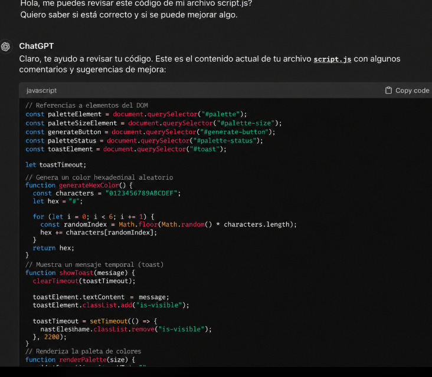
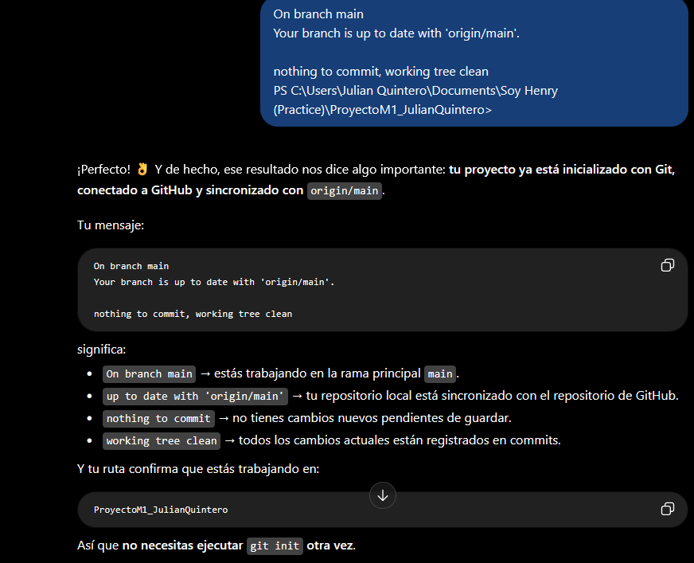

# Documentación del uso de Inteligencia Artificial

## 1. Objetivo

Durante el desarrollo de Colorfly Studio utilicé ChatGPT como herramienta de apoyo para resolver dudas técnicas, comprender algunos conceptos y buscar soluciones a problemas que surgieron durante la implementación.

El objetivo fue utilizar la inteligencia artificial como recurso de consulta y aprendizaje, manteniendo mi participación en el desarrollo, la revisión del código y las pruebas de funcionamiento.

## 2. Herramienta utilizada

- ChatGPT (OpenAI).

## 3. ¿Cómo utilicé la inteligencia artificial?

Utilicé ChatGPT principalmente para consultar dudas concretas relacionadas con HTML, CSS, JavaScript, Git y GitHub Pages.

Las consultas estuvieron orientadas a comprender el funcionamiento de determinadas instrucciones, identificar posibles errores y conocer alternativas para mejorar algunas características del proyecto.

La ayuda recibida se revisó teniendo en cuenta la estructura existente de la aplicación. Posteriormente, realicé pruebas para comprobar el comportamiento de las funcionalidades modificadas.

## 4. Ejemplos de consultas y aprendizajes

### Consulta 1. HTML semántico y accesibilidad

**Objetivo:** Comprender el propósito de las etiquetas semánticas y de algunos atributos de accesibilidad utilizados en la aplicación.

**Aprendizaje:** Reconocer cómo la estructura HTML contribuye a organizar el contenido y facilitar su interpretación por parte de los usuarios y las tecnologías de asistencia.

### Consulta 2. Generación aleatoria de colores

**Objetivo:** Resolver dudas sobre la generación de códigos hexadecimales y el uso de JavaScript para mostrar los colores en la página.

**Aprendizaje:** Comprender el uso de funciones, variables y manipulación del DOM en la generación dinámica de las tarjetas.

### Consulta 3. Actualización del selector de la paleta

**Objetivo:** Consultar cómo actualizar la cantidad de colores cuando el usuario cambia la opción seleccionada.

**Aprendizaje:** Comprender el evento `change` y la reutilización de la función `renderPalette()`.

### Consulta 4. Copia de códigos HEX

**Objetivo:** Buscar orientación para implementar la copia de códigos de color desde las tarjetas.

**Aprendizaje:** Comprender el uso de eventos `click`, la API del portapapeles y el manejo de posibles errores.

### Consulta 5. Estilos y diseño responsive

**Objetivo:** Resolver dudas relacionadas con la presentación visual de la aplicación y su adaptación a diferentes tamaños de pantalla.

**Aprendizaje:** Comprender cómo las reglas CSS y las media queries permiten mejorar la presentación en dispositivos con distintas dimensiones.

### Consulta 6. Git y GitHub Pages

**Objetivo:** Aclarar dudas sobre el registro de cambios, el uso de commits y la publicación del proyecto.

**Aprendizaje:** Comprender la función de comandos como `git status`, `git add`, `git commit` y `git push`, así como la importancia de revisar el estado del repositorio antes de subir cambios.

*Nota: los ejemplos anteriores resumen los temas de consulta. Las capturas de conversaciones originales se utilizarán como evidencia cuando estén disponibles.*

## 5. Participación y responsabilidad del estudiante

Durante el desarrollo fue necesario revisar las sugerencias recibidas, comprender las instrucciones utilizadas y comprobar los resultados en la aplicación.

Las pruebas manuales permitieron verificar que la paleta se generara correctamente y que los botones de copia mostraran la respuesta esperada.

La inteligencia artificial se utilizó como apoyo para resolver dudas y orientar mejoras, sin sustituir la responsabilidad de comprender el funcionamiento del proyecto y revisar los cambios realizados.

## 6. Aprendizajes obtenidos

El proceso permitió reforzar conocimientos relacionados con:

- HTML semántico y accesibilidad.
- CSS y diseño responsive.
- JavaScript y manipulación del DOM.
- Eventos y generación dinámica de elementos.
- Manejo de errores.
- Git y GitHub.
- Despliegue mediante GitHub Pages.

## 7. Consideración ética

La inteligencia artificial se utilizó como herramienta de apoyo educativo. Su utilización implicó revisar las sugerencias recibidas y comprobar los resultados antes de incorporarlos al proyecto.

La responsabilidad sobre el código final, su funcionamiento y la documentación entregada corresponde al estudiante.

---

## 8. Evidencias del uso de Inteligencia Artificial

En esta sección se presentan evidencias de consultas realizadas a ChatGPT durante el proceso de aprendizaje y desarrollo de Colorfly Studio.

Las capturas permiten mostrar algunos de los temas consultados y las explicaciones recibidas.

### Evidencia 1. Consulta sobre JavaScript

Se presenta una conversación relacionada con un error de JavaScript al utilizar el método `push()`.

La explicación permitió comprender la importancia de inicializar correctamente los arreglos antes de agregar elementos.

Esta captura se incluye como evidencia de aprendizaje de JavaScript y no como prueba de una funcionalidad específica de Colorfly Studio.

### Evidencia 2. Consulta sobre Git y GitHub

Se incluye una conversación en la que se consultó el significado de los mensajes mostrados por Git después de revisar el estado del repositorio.

La explicación permitió comprender los conceptos de rama principal, sincronización con el repositorio remoto y directorio de trabajo limpio.

### Evidencia 3. Pruebas de funcionamiento de Colorfly Studio

Como parte de la documentación del proyecto, se incorporarán capturas de la aplicación funcionando en el navegador.

Estas evidencias permitirán mostrar:

- La generación aleatoria de paletas.
- La selección de 6, 8 o 9 colores.
- La actualización de la paleta al cambiar el selector.
- La función para copiar códigos HEX.

**Estado:** pendiente de incorporar las capturas correspondientes a la aplicación desarrollada.

### Reflexión sobre el uso de IA

Las consultas realizadas permitieron reforzar conceptos técnicos y comprender mejor algunas herramientas utilizadas durante el proyecto.

Las sugerencias recibidas se revisaron antes de incorporarlas al trabajo, manteniendo la responsabilidad sobre el aprendizaje, las pruebas y la documentación.

---

Estudiante: Julian Andres Quintero